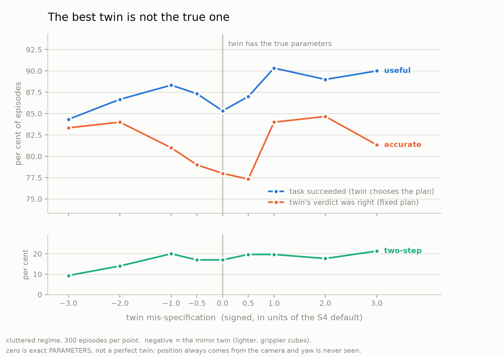
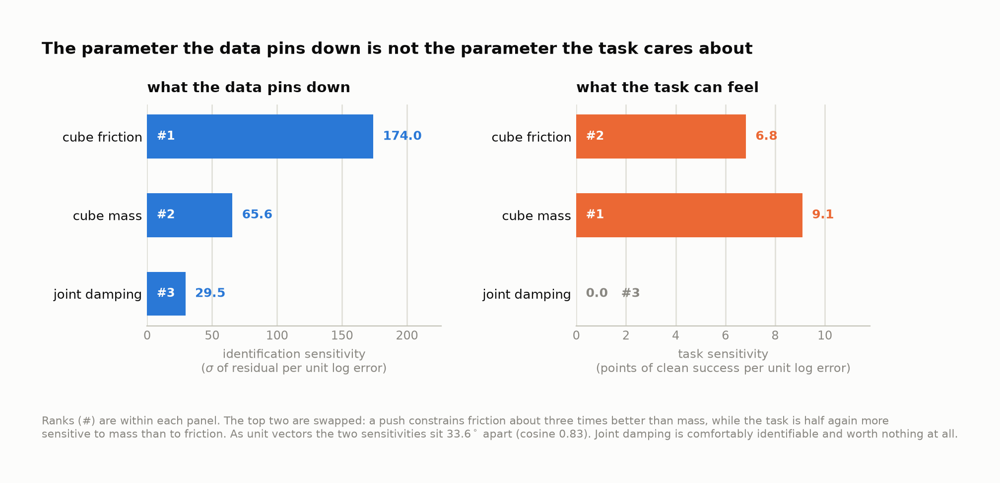

# fieldtwin

**A language-commanded tabletop manipulator that simulates its plan before it acts, and checks the result after.**

You say *"put the red cube where the blue cube is"*. The system looks at the
table, grounds that onto an object, builds a plan, **rolls the plan out in a
digital twin first**, repairs the plan if the twin says it will fail, executes,
and then **checks the outcome from a photograph**. Where the twin's prediction
and the camera's verdict disagree is the interesting part, and the thing the
project is built to study.

That loop is the whole idea. It puts digital twins, world models and
vision-language models to work on one real job instead of three demos.

> **The write-up is [`paper/paper.pdf`](paper/paper.pdf)** — 20 pages, 45
> references, every number in it generated from `results/*.json` rather than
> typed, so a stale figure is a build error. Build it with `make -C paper`.

```
    look ──▶ ground ──▶ plan ──▶ SIMULATE in the twin
                         ▲                 │
                         └── repair ◀── predicted to fail
                                           │
                                  predicted ok ──▶ execute ──▶ LOOK AGAIN, verify
                                                                   │
                                            twin said yes, camera says no ──▶ log it
```

The loop runs end to end today with a geometric grounder and a geometric
verifier. S3 swaps a VLM into those two sockets and scores it against the
baseline they already set.

## What works today

The whole loop runs. A Franka Panda takes a written instruction — *"put the cube
nearest the pipe on the green pad"* — **looks at the table through its own
overhead camera**, builds a plan, **rolls that plan out in a deliberately
imperfect twin**, repairs it if the twin says it will fail, executes, and then
**checks the result from a second photograph**.

Three arms over four seeds, 300 episodes each per regime, every arm on identical
layouts and identical instructions:

| | open (3 cubes) | cluttered (5 cubes) |
|---|---|---|
| direct — one pick-and-place, no simulation | 88.3% | 79.3% |
| **the loop — simulate, repair, execute** | **96.7%** | **90.3%** |
| *of which:* put X **where Y is** (destination occupied) | 66.7% → **90.5%** | 55.6% → **80.6%** |

Compared episode by episode against the direct arm, the loop **rescued 25 and
broke 0** on open (McNemar p = 6 × 10⁻⁸) and **rescued 34, broke 1** on
cluttered (p = 2 × 10⁻⁹). It costs a mean of 1.2–1.3 simulated rollouts per
episode, roughly doubling wall-clock time to 0.5–0.7 s.

*Clean success* means the goal predicate is true **and** no object the
instruction did not license moving was disturbed by more than 30 mm. Knocking
the rest of the scene around while completing a task is a failure, not a detail.

### The two things worth knowing

**The verifier catches what the skill cannot.** Across all 1,800 episodes the
skill reported success on 94 episodes where the task had actually failed — it
grasped, carried and released, and from inside the action that is
indistinguishable from success. The camera verifier made 1,599 success calls
and **not one of them was wrong**. Its only mistakes are conservative: 8
episodes it called failures that were clean.

**The twin with the plant's true parameters is the worst twin to plan with.**
S5 swept the mis-specification through zero and out the other side, as a signed
magnitude so that −1 is the exact mirror of +1. Both curves bottom out at the
true parameters — it is neither the most useful (85.3%, against 90.3%) nor the
most accurate (78.0%, against 84.7%):



The reason is that the twin's dominant error was never its physics. Crossing its
two kinds of ignorance — wrong physics, and blindness to which way a cube is
turned — shows they are **substitutes, not additive**: fixing either lifts the
worst cell about five points, and fixing both lifts it the same five points and
no more.

| clean success | yaw unseen | yaw known |
|---|---|---|
| **exact physics** | **85.3%** | 90.7% |
| **mis-specified physics** | 90.3% | 90.3% |

A twin exactly right about mass, friction and damping but wrong about the
*scene* faithfully simulates a grasp on a square-on cube and reports that it
works — when every cube is turned by up to 23°. Pessimistic physics error
cancels that optimism, and is worth exactly as much as actually seeing the
orientation, and no more.

**And accuracy alone is not the point.** The optimistic twin at −3 is as
accurate overall as the good one at +1, and is the worst arm in the sweep. It is
right by agreeing with the common case — it predicts success 88.7% of the time
when the truth is 79.3% — and carries the sweep's highest false confidence.
False confidence is the error you *act on*. **The twin's job is to be right
about the failures.**

**What the data pins down is not what the task cares about.** Over the same
three parameters: a push constrains friction ≈3× better than mass, while the
task is half again more sensitive to mass than friction — the top two swapped,
the two sensitivity vectors 33.6° apart. Joint damping is cleanly identifiable
and worth *nothing* to the task (85.5% either way, against 85.3% baseline).

So the effort should go to perception, not to identifying physics: the twin's
dominant error is a state it cannot see, not a parameter it has wrong.
[docs/findings.md](docs/findings.md) F8–F11 have the detail and the caveats.



**The loop flags the episodes it could not check, and the flag is worth
something.** A plan the twin never endorsed inside its budget is executed
anyway but marked `confident=False`. Those 19 episodes are clean **31.6%** of
the time against **93.0%** for the 1,181 endorsed ones, at 98.4% coverage — and
the flag never fires at all in the open regime, so it is tracking difficulty
rather than firing at random. It costs nothing: it is a by-product of the budget
the loop already spends (F12).

**One scoring constant in this project is untested, and it is reported as such.**
Clean success forbids displacing a protected object by more than 30 mm. In all
1,800 episodes that clause never binds — no episode met its goal and failed on
displacement, and the largest displacement seen anywhere was 29.4 mm. Re-scoring
at 10 mm costs both cluttered arms about three points and leaves the paired
result intact (+31/−1, p = 2×10⁻⁸), so the headline does not depend on where the
line is drawn; but the rule's deterrent function is unexercised by these runs
(F13).

### Underneath

The instruction generator produces about 53 well-posed instructions per layout
across five reference types (colour, nearest/farthest from a landmark,
left/right of another cube, left/right of a landmark, superlatives) and five
goal types, refusing ambiguous references and already-satisfied goals. The
camera estimator locates every cube to a **1.7 mm median error** in 37 ms, by
hue segmentation and un-projection — no learned component, so it is the baseline
an S3 VLM has to beat. References are still resolved from ground truth, so that
when a VLM grounder replaces that, the drop is attributable to grounding.

One caution on reading any single number here: at n ≈ 300 an absolute success
rate on this benchmark carries about ±7 points of **seed** noise
([docs/findings.md](docs/findings.md) F7). The paired comparisons are the claims;
the absolute rates are context.

## Build split

Roughly 60% established libraries, 40% written here — on purpose, so the
ecosystem gets learned rather than reinvented.

| From libraries | Written here |
|---|---|
| **MuJoCo** physics and rendering | Scene composition via `MjSpec` |
| **MuJoCo Menagerie** (via `robot_descriptions`) — the Panda model, unmodified | Grasp conventions and pose math |
| **mink** — differential IK, frame/posture tasks, joint limits | The skill layer: approach/retreat structure, success predicates |
| **NumPy / SciPy** | The plan–simulate–verify loop and its repair catalogue |
| **MuJoCo** offscreen `Renderer` | The camera estimator: hue segmentation and un-projection |
| **Pillow** image pipeline | Task specification and the evaluation harness |
| *(planned)* a small open VLM for grounding and verification | The grounding adapter and its calibration |

Nothing from Menagerie is forked or copied. The arm is loaded as its
maintainers ship it, and the table, objects, cameras and tool-centre-point are
attached programmatically, so an upstream fix arrives for free.

## Setup

```bash
uv venv --python 3.12
uv pip install -e .
```

## Run

```bash
.venv/bin/python -m pytest tests/ -q
```

```bash
.venv/bin/python experiments/demo_pick_place.py
```

That renders an episode to `results/visuals/pick_place.gif` and benchmarks the
skill over 60 randomised layouts.

```bash
.venv/bin/python experiments/demo_loop.py
```

One occupied-destination task run twice — once straight, once through the twin —
rendered from the robot's own overhead camera into
`results/figures/s4_loop.png`.

```bash
.venv/bin/python experiments/bench_loop.py 15 5 0,1,2,3
```

The S4 benchmark: three arms over four seeds, paired episode by episode.

```bash
.venv/bin/python experiments/sweep_fidelity.py sweep 15 5 0,1,2,3
```

The S5 sweep: the twin's mis-specification swept through zero and out the other
side, into `results/figures/s5_fidelity.png`. `factorial` crosses the twin's two
kinds of ignorance instead, and `directions` asks which parameter carries the
effect.

```bash
.venv/bin/python experiments/identify_task.py
```

Identification curvature over the same three parameters, for comparison with
what the task is actually sensitive to.

```bash
make -C paper
```

Regenerates every table and inline number from `results/*.json` and builds
[`paper/paper.pdf`](paper/paper.pdf). Needs `tectonic`; takes about 20 seconds
and runs no simulation. `make -C paper figures` re-renders the two figures that
are drawn rather than simulated.

## Layout

```
fieldtwin/
  arena.py       scene composition: Panda + table + objects + cameras (MjSpec)
  robot.py       IK via mink, Cartesian moves, gripper, the look pose
  skills.py      pick / place / push, each with an explicit success condition
  tasks.py       references, goal predicates, the instruction generator
  perceive.py    overhead camera -> estimated object positions
  plan.py        plans as data, and the repair catalogue
  twin.py        the mis-specified twin, and the simulate-repair-execute loop
  verify.py      re-checking the goal predicate from a photograph
  evaluate.py    the shared episode runner and the paired comparison
  bus.py         simulated servo bus: rate, latency, jitter, dropout, encoder
  plant.py       World; the plant/twin pair
  models/        the parameter space a twin has to identify
  identify/      identification loss and curvature spectrum
experiments/     runnable entry points
```

## The twin-fidelity half

`bus.py`, `plant.py`, `models/` and `identify/` are the other half of the idea.
If the system is going to trust a simulated rollout before acting, somebody has
to answer *how wrong is the twin allowed to be before that rollout stops being
worth anything*. Those modules measure exactly that; [docs/findings.md](docs/findings.md)
records what they have reported so far, including a real methodological trap
(F5) that a relative eigenvalue threshold walks straight into.

See [PLAN.md](PLAN.md) for where this goes next.
