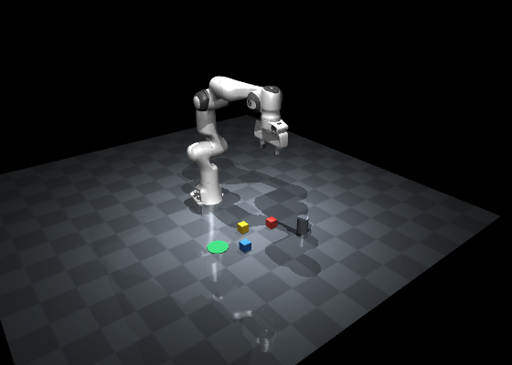
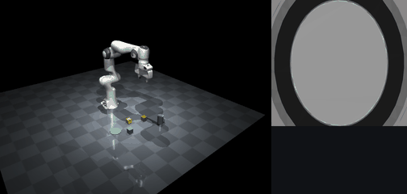
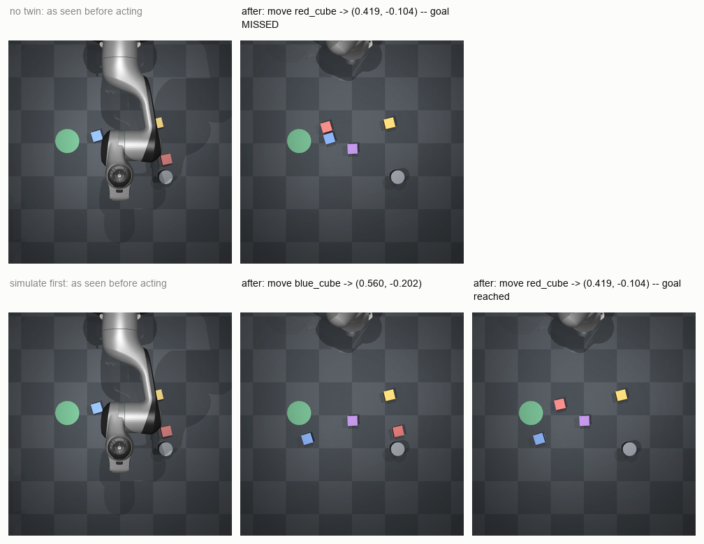
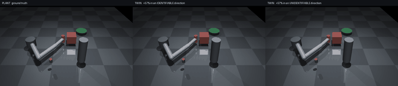

# fieldtwin

**A language-commanded tabletop manipulator that simulates its plan before it acts, and checks the result after.**



You say *"put the red cube where the blue cube is"*. The system looks at the
table through its own overhead camera, grounds that instruction onto an object,
builds a plan, **rolls the plan out in a deliberately imperfect digital twin**,
repairs the plan if the twin says it will fail, executes, and then **checks the
outcome from a second photograph**. Where the twin's prediction and the camera's
verdict disagree is the interesting part, and the thing this project is built to
study.

```
    look ──▶ ground ──▶ plan ──▶ SIMULATE in the twin
                         ▲                 │
                         └── repair ◀── predicted to fail
                                           │
                                  predicted ok ──▶ execute ──▶ LOOK AGAIN, verify
                                                                   │
                                            twin said yes, camera says no ──▶ log it
```



> **The write-up is [`paper/paper.pdf`](paper/paper.pdf)** — 20 pages, 45
> references, every number generated from `results/*.json` rather than typed, so
> a stale figure is a build error. Build it with `make -C paper`.

## Results

Three arms over four seeds, 300 episodes each per regime, every arm on identical
layouts and identical instructions:

| | open (3 cubes) | cluttered (5 cubes) |
|---|---|---|
| direct — one pick-and-place, no simulation | 88.3% | 79.3% |
| **the loop — simulate, repair, execute** | **96.7%** | **90.3%** |
| *of which:* put X **where Y is** (destination occupied) | 66.7% → **90.5%** | 55.6% → **80.6%** |

Compared episode by episode against the direct arm, the loop **rescued 25 and
broke 0** on open (McNemar p = 6 × 10⁻⁸) and **rescued 34, broke 1** on
cluttered (p = 2 × 10⁻⁹), at a mean of 1.2–1.3 simulated rollouts per episode.

*Clean success* means the goal predicate is true **and** no object the
instruction did not license moving was disturbed by more than 30 mm. Knocking
the rest of the scene around while completing a task is a failure, not a detail.

Here is the whole mechanism in one picture. Top row acts directly and pushes the
red cube into an occupied spot. Bottom row rehearses first, discovers the
collision, moves the blue cube out of the way, and reaches the goal.



## The two things worth knowing

**The verifier catches what the skill cannot.** Across all 1,800 episodes the
skill reported success on 94 episodes where the task had actually failed. It
grasped, carried and released, and from inside the action that is
indistinguishable from success. The camera verifier made 1,599 success calls and
**not one of them was wrong**. Its only mistakes are conservative: 8 episodes it
called failures that were clean.

**The twin holding the plant's true parameters is the worst twin to plan with.**
The sweep runs mis-specification through zero and out the other side, as a signed
magnitude so that −1 is the exact mirror of +1. Both curves bottom out at the
true parameters. It is neither the most useful (85.3%, against 90.3%) nor the
most accurate (78.0%, against 84.7%):


The reason is that the twin's dominant error was never its physics. Crossing its
two kinds of ignorance, wrong physics and blindness to which way a cube is
turned, shows they are **substitutes, not additive**. Fixing either lifts the
worst cell about five points, and fixing both lifts it the same five points and
no more.

| clean success | yaw unseen | yaw known |
|---|---|---|
| **exact physics** | **85.3%** | 90.7% |
| **mis-specified physics** | 90.3% | 90.3% |

A twin exactly right about mass, friction and damping but wrong about the
*scene* faithfully simulates a grasp on a square-on cube and reports that it
works, when every cube is turned by up to 23°. Pessimistic physics error cancels
that optimism, and is worth exactly as much as seeing the orientation, and no
more.

Accuracy alone is also not the point. The optimistic twin is as accurate overall
as the good one and is the worst arm in the sweep. It is right by agreeing with
the common case, and carries the sweep's highest false confidence. False
confidence is the error you *act on*. **The twin's job is to be right about the
failures.**

## What the data pins down is not what the task cares about

Three worlds, same command: the true plant, a twin wrong in a direction a
calibration push can measure, and a twin wrong in a direction it cannot.



Over the same three parameters, a push constrains friction ≈3× better than mass
while the task is half again more sensitive to mass than friction. The top two
are swapped, and the two sensitivity vectors sit 33.6° apart. Joint damping is
cleanly identifiable and worth *nothing* to the task.


So the effort belongs in perception, not in identifying physics. The twin's
dominant error is a state it cannot see, not a parameter it has wrong.

## Caveats

- **The loop flags what it could not check.** A plan the twin never endorsed
  inside its budget runs anyway, marked `confident=False`. Those 19 episodes are
  clean 31.6% of the time against 93.0% for endorsed ones, at 98.4% coverage.
- **Absolute rates carry about ±7 points of seed noise** at n ≈ 300. The paired
  comparisons are the claims; the absolute rates are context.
- **One scoring constant is untested.** The 30 mm displacement clause never
  binds in 1,800 episodes. Re-scoring at 10 mm leaves the paired result intact.
- **References are resolved from ground truth**, so that when a VLM grounder
  replaces the geometric one, the drop is attributable to grounding.

[docs/findings.md](docs/findings.md) has the detail, the caveats and two entries
that correct earlier claims of my own.

## Build split

Roughly 60% established libraries, 40% written here, on purpose, so the
ecosystem gets learned rather than reinvented.

| From libraries | Written here |
|---|---|
| **MuJoCo** physics and rendering | Scene composition via `MjSpec` |
| **MuJoCo Menagerie** — the Panda model, unmodified | Grasp conventions and pose math |
| **mink** — differential IK, frame/posture tasks, joint limits | The skill layer and its success predicates |
| **NumPy / SciPy** | The plan–simulate–verify loop and its repair catalogue |
| **MuJoCo** offscreen `Renderer` | The camera estimator: hue segmentation and un-projection |
| **Pillow** image pipeline | Task specification and the evaluation harness |

Nothing from Menagerie is forked or copied. The arm is loaded as its maintainers
ship it, and the table, objects, cameras and tool-centre-point are attached
programmatically, so an upstream fix arrives for free.

The camera estimator locates every cube to a **1.7 mm median error in 37 ms**,
with no learned component, so it is the baseline a VLM grounder has to beat.

## Setup

```bash
uv venv --python 3.12
uv pip install -e .
```

## Run

```bash
.venv/bin/python -m pytest tests/ -q
```

```bash
.venv/bin/python experiments/demo_loop.py
```

One occupied-destination task run twice, once straight and once through the
twin, rendered into `results/figures/s4_loop.png`.

```bash
.venv/bin/python experiments/bench_loop.py 15 5 0,1,2,3
```

The headline benchmark: three arms over four seeds, paired episode by episode.

```bash
.venv/bin/python experiments/sweep_fidelity.py sweep 15 5 0,1,2,3
```

The fidelity sweep. `factorial` crosses the twin's two kinds of ignorance
instead, and `directions` asks which parameter carries the effect.

```bash
make -C paper
```

Regenerates every table and inline number from `results/*.json` and builds
[`paper/paper.pdf`](paper/paper.pdf). Needs `tectonic`, takes about 20 seconds
and runs no simulation.

Other entry points live in [`experiments/`](experiments), each runnable on its
own.

## Layout

```
fieldtwin/
  arena.py       scene composition: Panda + table + objects + cameras (MjSpec)
  robot.py       IK via mink, Cartesian moves, gripper, the look pose
  skills.py      pick / place / push, each with an explicit success condition
  tasks.py       references, goal predicates, the instruction generator
  perceive.py    overhead camera -> estimated object positions
  plan.py        plans as data, and the repair catalogue
  twin.py        the mis-specified twin, and the simulate-repair-execute loop
  verify.py      re-checking the goal predicate from a photograph
  evaluate.py    the shared episode runner and the paired comparison
  bus.py         simulated servo bus: rate, latency, jitter, dropout, encoder
  plant.py       World; the plant/twin pair
  models/        the parameter space a twin has to identify
  identify/      identification loss and curvature spectrum
experiments/     runnable entry points
```

`bus.py`, `plant.py`, `models/` and `identify/` answer the other half of the
question: *how wrong is the twin allowed to be before a rollout stops being worth
anything*. See [PLAN.md](PLAN.md) for where this goes next.
